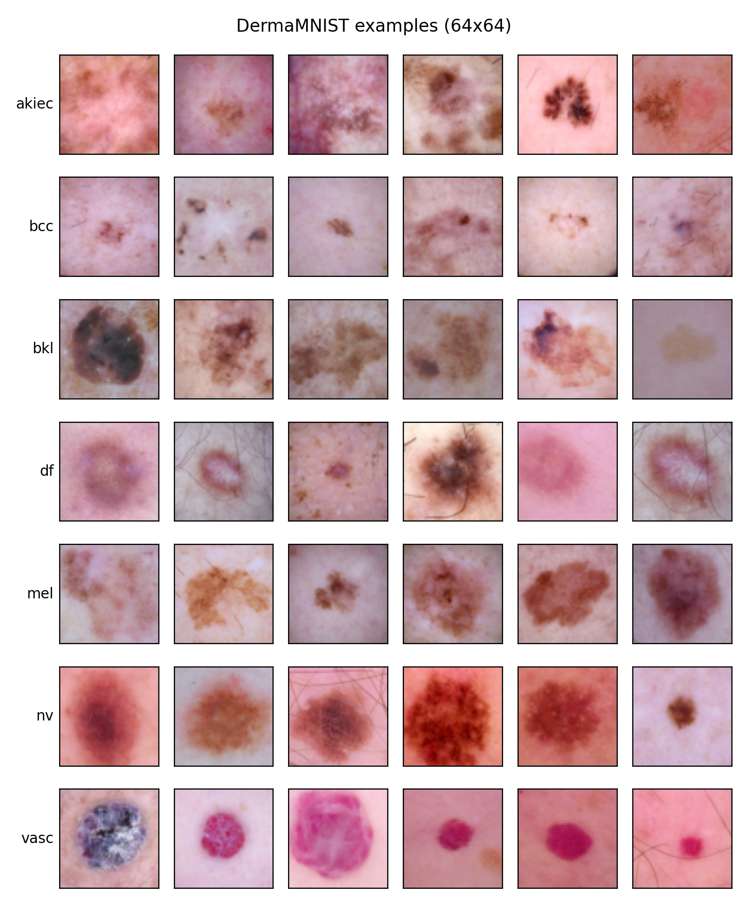
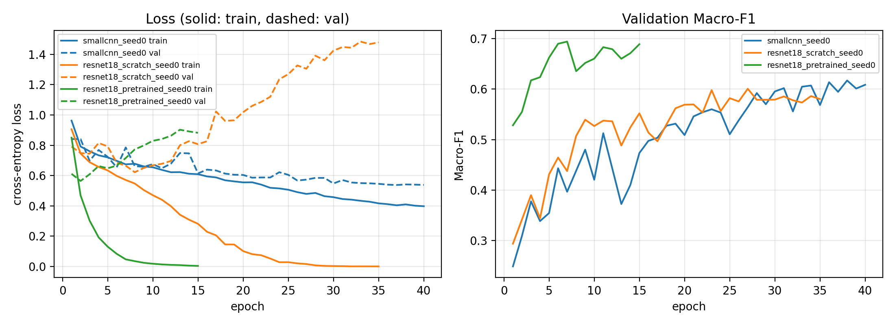

# Does ImageNet pretraining help on small, imbalanced medical images? A study on DermaMNIST

> Work in progress (day 1 of 3): baseline results on the validation set.

**Question.** On DermaMNIST (7 skin-lesion classes, highly imbalanced), how do a small custom CNN, a ResNet-18 trained from scratch and an ImageNet-pretrained ResNet-18 compare? Which imbalance strategy works best, is the model's confidence trustworthy (calibration), and where does it look (Grad-CAM)?

Everything is written in plain PyTorch: training loop, early stopping, Focal Loss, Grad-CAM (hooks) and temperature scaling.

## Data
DermaMNIST (MedMNIST v3, from HAM10000), 64×64 RGB, official train / val / test split.

| Class | Lesion type | Train | Val | Test | Train % | Class weight |
|---|---|---:|---:|---:|---:|---:|
| akiec | Actinic keratoses / intraepithelial carcinoma | 228 | 33 | 66 | 3.25 | 4.39 |
| bcc | Basal cell carcinoma | 359 | 52 | 103 | 5.12 | 2.79 |
| bkl | Benign keratosis-like lesions | 769 | 110 | 220 | 10.97 | 1.30 |
| df | Dermatofibroma | 80 | 12 | 23 | 1.14 | 12.51 |
| mel | Melanoma | 779 | 111 | 223 | 11.12 | 1.29 |
| nv | Melanocytic nevi | 4693 | 671 | 1341 | 66.98 | 0.21 |
| vasc | Vascular lesions | 99 | 14 | 29 | 1.41 | 10.11 |
| **Total** | | **7007** | **1003** | **2005** | | |

The largest class is 59× the smallest (nv vs df). Class weights are computed on the training split only, as w_c = N / (K · n_c).




## Models
| Model | Parameters | Initialization | Learning rate |
|---|---:|---|---|
| SmallCNN (3 conv blocks + GAP) | 288K | random | 1e-3 |
| ResNet-18 | 11.18M | random | 1e-3 |
| ResNet-18 | 11.18M | ImageNet | 1e-4 backbone, 1e-3 head |

The two ResNet-18s have the same architecture; only the initialization differs, so any gap between them is due to pretraining.

## Setup
- AdamW (weight decay 1e-4), cosine learning-rate schedule, batch size 128, at most 40 epochs, mixed precision on GPU.
- Model selection and early stopping (patience 8) on **validation Macro-F1**. Accuracy is misleading here: always predicting `nv` gives 66.9% accuracy but only 0.115 Macro-F1.
- The test set is used once, at the end.

## Results

### Experiment A: baseline (plain cross-entropy, horizontal flip, seed 0, validation set)

| Model | Macro-F1 | Balanced acc. | AUC (macro) | Accuracy | Best epoch / epochs run |
|---|---:|---:|---:|---:|---:|
| Always predict `nv` | 0.115 | 0.143 | – | 0.669 | – |
| SmallCNN | 0.617 | 0.575 | **0.951** | 0.812 | 38 / 40 |
| ResNet-18, scratch | 0.601 | 0.600 | 0.907 | 0.763 | 27 / 35 |
| ResNet-18, ImageNet-pretrained | **0.694** | **0.675** | 0.943 | **0.815** | 7 / 15 |



**Observations**
1. **Pretraining helps, and helps early.** The pretrained ResNet-18 reaches the best Macro-F1 (+0.09 over the same network trained from scratch) and gets there in 7 epochs instead of 27.
2. **The scratch ResNet-18 memorizes the training set.** Its training loss drops to ≈0 while its validation loss climbs from 0.62 to 1.48: 11M parameters on 7k images overfit badly without pretraining. The 39× smaller SmallCNN matches it in Macro-F1 and beats it in AUC.
3. **SmallCNN has not finished learning.** Its validation loss is still decreasing and its best epoch is 38 of 40, so it is limited by the training budget, not by overfitting.
4. **Validation loss and Macro-F1 disagree.** For the pretrained model, validation loss is lowest at epoch 2 and rises afterwards, while Macro-F1 keeps improving until epoch 7. The model keeps getting the same images right but becomes over-confident on the ones it gets wrong. This points to poor calibration, which is studied later (temperature scaling).
5. **High AUC, lower Macro-F1.** SmallCNN ranks the classes well (AUC 0.951) but its arg-max decisions favour the majority class (balanced accuracy 0.575). This is the gap that the imbalance strategies (weighted loss, Focal Loss, oversampling) are meant to close.

**Caveats.** These numbers come from a single seed on the validation set (1,003 images, of which only 12 are `df` and 14 are `vasc`), so differences of 1–2 points are within noise. Final conclusions will use 3 seeds and the test set.

### Next
- Experiment B: class-imbalance strategies (weighted cross-entropy, Focal Loss, oversampling).
- Experiment C: augmentation ablation.
- Experiment D: final comparison of the three models, 3 seeds, test set.
- Grad-CAM and calibration (ECE, reliability diagrams, temperature scaling).

## Reproduce
```bash
pip install -r requirements.txt && pip install -e .
pytest -q
python scripts/eda.py --data_root data
python scripts/train.py --config configs/resnet18_pretrained.yaml --seed 0
```
