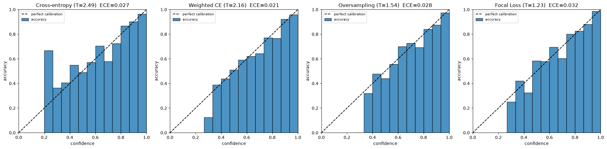
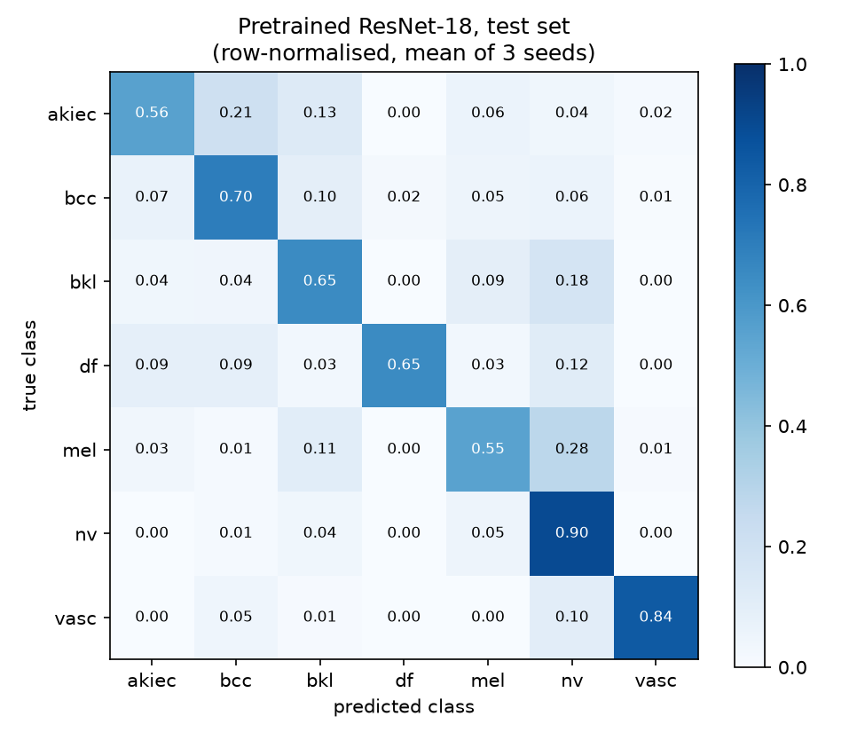
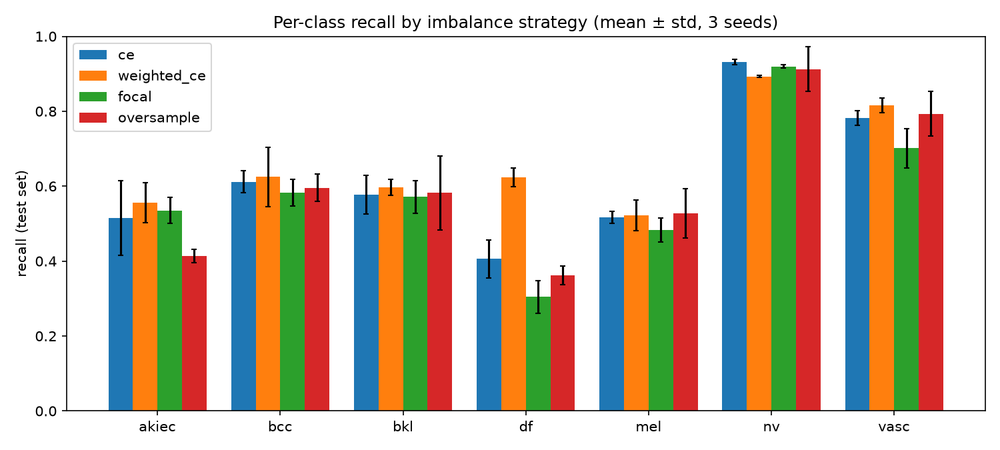
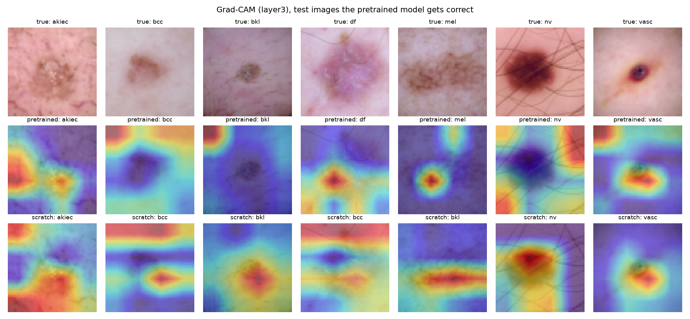
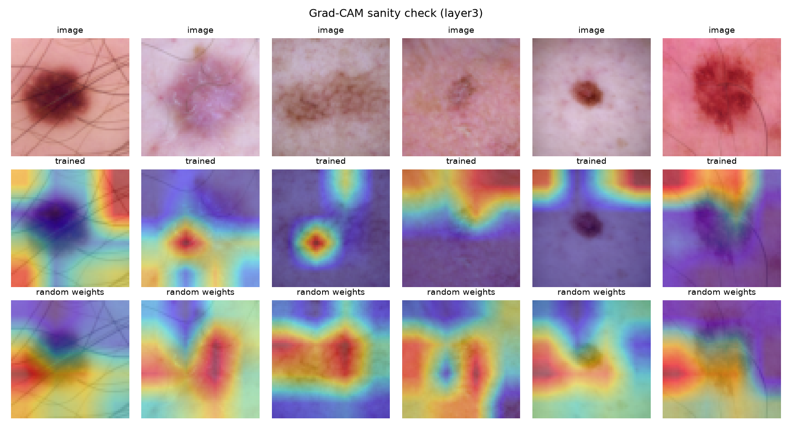

# Does ImageNet pretraining help on small, imbalanced medical images? A study on DermaMNIST

> **Status.** Experiments A–E, final test-set evaluation,
> calibration, and Grad-CAM analysis are complete.
> The project is being prepared for its v1.0 release.

**Question.** On DermaMNIST (7 skin-lesion classes, highly imbalanced), how do a small custom CNN, a ResNet-18 trained from scratch and an ImageNet-pretrained ResNet-18 compare? Which imbalance strategy works best, which augmentations help, is the model's confidence trustworthy (calibration), and where does it look (Grad-CAM)?

Everything is written in plain PyTorch: training loop, early stopping, Focal Loss, Grad-CAM (hooks) and temperature scaling.

## Key findings so far (validation set)
1. **Pretraining is the biggest effect.** With identical settings, the pretrained ResNet-18 reaches Macro-F1 0.684 ± 0.012, against 0.522 ± 0.036 for the same network from scratch and 0.446 ± 0.013 for the small CNN (3 seeds).
2. **Pretraining is worth more than 4× the data.** A pretrained ResNet-18 trained on 25% of the training set (≈1,750 images) scores 0.583, above the scratch model trained on 100% (0.522). The gap to scratch does not shrink as data grows (+0.09 at 10%, +0.11 at 25% and 50%, +0.16 at 100%).
3. **No imbalance strategy beat plain cross-entropy on Macro-F1.** Weighted CE, Focal Loss and oversampling are all within noise of the baseline (0.661–0.674).
4. **Flips matter, stronger augmentation trades precision for recall.** Adding flips raises Macro-F1 from 0.635 to 0.685. Rotation, colour jitter and zoom lower Macro-F1 but raise balanced accuracy and rare-class recall, at the cost of recall on the majority class.
5. **The fine-tuned model is over-confident, and the amount depends on the loss (preliminary, single-seed, validation-only).** ECE on validation is 0.127 with cross-entropy and 0.039 with Focal Loss. Temperature scaling brings every method to about 0.02–0.03 without changing a single prediction (optimistic: temperature fitted and measured on the same set; see Calibration).

## Data
DermaMNIST (MedMNIST v3, from HAM10000), 64×64 RGB, official train / val / test split.

| Class | Lesion type | Train | Val | Test | Train % | Class weight |
|---|---|---:|---:|---:|---:|---:|
| akiec | Actinic keratoses / intraepithelial carcinoma | 228 | 33 | 66 | 3.25 | 4.39 |
| bcc | Basal cell carcinoma | 359 | 52 | 103 | 5.12 | 2.79 |
| bkl | Benign keratosis-like lesions | 769 | 110 | 220 | 10.97 | 1.30 |
| df | Dermatofibroma | 80 | 12 | 23 | 1.14 | 12.51 |
| mel | Melanoma | 779 | 111 | 223 | 11.12 | 1.29 |
| nv | Melanocytic nevi | 4693 | 671 | 1341 | 66.98 | 0.21 |
| vasc | Vascular lesions | 99 | 14 | 29 | 1.41 | 10.11 |
| **Total** | | **7007** | **1003** | **2005** | | |

The largest class is 59× the smallest (nv vs df). Class weights are computed on the training split only, as w_c = N / (K · n_c).


## Models
| Model | Parameters | Initialization | Learning rate |
|---|---:|---|---|
| SmallCNN (3 conv blocks + GAP) | 288K | random | 1e-3 |
| ResNet-18 | 11.18M | random | 1e-3 |
| ResNet-18 | 11.18M | ImageNet | 1e-4 backbone, 1e-3 head |

The two ResNet-18s have the same architecture; only the initialization differs, so any gap between them is due to pretraining.

## Setup
- AdamW (weight decay 1e-4), cosine learning-rate schedule, batch size 128, at most 40 epochs (60 in experiments D and E), mixed precision on GPU.
- Model selection and early stopping (patience 8) on **validation Macro-F1**. Accuracy is misleading here: always predicting `nv` gives 66.9% accuracy but only 0.115 Macro-F1.
- Experiment A uses one seed. Experiments B, C and D use 3 seeds, E uses 2. Tables report mean ± standard deviation over seeds.
- Validation loss is always plain cross-entropy, whatever loss the model is trained with, so runs are comparable.
- All results below are on the **validation set**. The test set has not been used yet and will be used once, at the end.

## Results

### Experiment A: baseline (plain cross-entropy, horizontal flip, seed 0)

| Model | Macro-F1 | Balanced acc. | AUC (macro) | Accuracy | Best epoch / epochs run |
|---|---:|---:|---:|---:|---:|
| Always predict `nv` | 0.115 | 0.143 | – | 0.669 | – |
| SmallCNN | 0.617 | 0.575 | **0.951** | 0.812 | 38 / 40 |
| ResNet-18, scratch | 0.601 | 0.600 | 0.907 | 0.763 | 27 / 35 |
| ResNet-18, ImageNet-pretrained | **0.694** | **0.675** | 0.943 | **0.815** | 7 / 15 |


**Observations**
1. **Pretraining helps, and helps early.** The pretrained ResNet-18 reaches the best Macro-F1 (+0.09 over the same network trained from scratch) and gets there in 7 epochs instead of 27.
2. **The scratch ResNet-18 memorizes the training set.** Its training loss drops to ≈0 while its validation loss climbs from 0.62 to 1.48: 11M parameters on 7k images overfit badly without pretraining. The 39× smaller SmallCNN matches it in Macro-F1 and beats it in AUC.
3. **SmallCNN has not finished learning.** Its validation loss is still decreasing and its best epoch is 38 of 40, so it is limited by the training budget, not by overfitting.
4. **Validation loss and Macro-F1 disagree.** For the pretrained model, validation loss is lowest at epoch 2 and rises afterwards, while Macro-F1 keeps improving until epoch 7. The model keeps getting the same images right but becomes over-confident on the ones it gets wrong. Experiment B's calibration analysis confirms this.
5. **High AUC, lower Macro-F1.** SmallCNN ranks the classes well (AUC 0.951) but its arg-max decisions favour the majority class (balanced accuracy 0.575). This is the gap that the imbalance strategies are meant to close.

**Caveat.** One seed, and only 12 `df` and 14 `vasc` images in validation, so differences of 1–2 points are within noise. The later experiments use 3 seeds.

### Experiment B: class-imbalance strategies (pretrained ResNet-18, 3 seeds)

Only the imbalance strategy changes; everything else is as in A (horizontal flip only).

| Strategy | Macro-F1 | Balanced acc. | AUC (macro) | Accuracy |
|---|---:|---:|---:|---:|
| Cross-entropy (baseline) | **0.674 ± 0.006** | 0.656 ± 0.005 | 0.944 ± 0.003 | **0.813 ± 0.002** |
| Weighted cross-entropy | 0.672 ± 0.026 | **0.670 ± 0.018** | 0.940 ± 0.006 | 0.794 ± 0.014 |
| Focal Loss | 0.661 ± 0.020 | 0.628 ± 0.024 | 0.940 ± 0.004 | 0.804 ± 0.007 |
| Oversampling | 0.666 ± 0.011 | 0.624 ± 0.015 | 0.945 ± 0.002 | 0.801 ± 0.028 |

Per-class recall (mean over 3 seeds):

| Strategy | akiec | bcc | bkl | df | mel | nv | vasc |
|---|---:|---:|---:|---:|---:|---:|---:|
| Cross-entropy | 0.545 | 0.718 | 0.573 | 0.556 | 0.538 | 0.925 | 0.738 |
| Weighted CE | 0.556 | 0.667 | 0.588 | 0.667 | 0.559 | 0.891 | 0.762 |
| Focal | 0.525 | 0.673 | 0.582 | 0.500 | 0.529 | 0.918 | 0.667 |
| Oversampling | 0.485 | 0.699 | 0.600 | 0.528 | 0.583 | 0.904 | 0.571 |

**Observations**
1. **The four strategies are statistically indistinguishable on Macro-F1** (0.661–0.674, with standard deviations up to 0.026). Plain cross-entropy has the highest mean and the lowest variance.
2. **Weighted CE is the only one that moves the balance**: it gives the best balanced accuracy and the best recall on `df` and `vasc`, but loses 2 points of accuracy. The gain in balanced accuracy (+0.014) is smaller than its standard deviation.
3. **The class-imbalance problem is not solved by re-weighting at this data size.** With 12 `df` and 14 `vasc` validation images, one image changes recall by 7–8 points, so per-class recall differences here are mostly noise.
4. The baseline run `expB_ce_seed0` reproduces experiment A (0.694 in A, 0.674 ± 0.006 over three seeds), which is a useful consistency check.

### Experiment C: augmentation ablation (pretrained ResNet-18, 3 seeds)

Five cumulative levels. Imbalance strategy: **weighted cross-entropy** for all levels, chosen after B because it gave the best balanced accuracy and the best recall on the rarest classes (its Macro-F1 difference from plain cross-entropy was within noise).

| Level | Adds | Macro-F1 | Balanced acc. | AUC (macro) | Accuracy | Best epoch |
|---|---|---:|---:|---:|---:|---:|
| 0 none | – | 0.635 ± 0.013 | 0.614 ± 0.008 | 0.936 ± 0.003 | 0.784 ± 0.007 | 17.7 |
| 1 flips | horizontal + vertical flip | **0.685 ± 0.021** | 0.698 ± 0.010 | **0.943 ± 0.006** | **0.797 ± 0.016** | 23.3 |
| 2 flips_rot | rotation (any angle) | 0.663 ± 0.011 | 0.729 ± 0.015 | 0.941 ± 0.008 | 0.763 ± 0.006 | 30.0 |
| 3 flips_rot_color | mild brightness / contrast / saturation / hue jitter | 0.649 ± 0.008 | **0.731 ± 0.021** | 0.941 ± 0.005 | 0.753 ± 0.006 | 30.0 |
| 4 full | random zoom (80–100%) | 0.627 ± 0.013 | 0.710 ± 0.011 | 0.938 ± 0.006 | 0.707 ± 0.022 | 30.3 |

Recall of selected classes:

| Level | akiec | bcc | mel | vasc | nv |
|---|---:|---:|---:|---:|---:|
| 0 none | 0.444 | 0.705 | 0.532 | 0.667 | 0.903 |
| 1 flips | 0.535 | 0.763 | 0.580 | 0.857 | 0.881 |
| 2 flips_rot | 0.667 | 0.821 | 0.640 | 0.833 | 0.804 |
| 3 flips_rot_color | 0.717 | 0.853 | 0.679 | 0.857 | 0.788 |
| 4 full | 0.646 | 0.840 | 0.670 | 0.905 | 0.725 |

**Observations**
1. **Flips are the one clear win**: +0.05 Macro-F1 and +0.08 balanced accuracy over no augmentation, with no cost in accuracy.
2. **Each further level trades the majority class for the minority classes.** Recall on `akiec`, `bcc` and `mel` keeps rising up to levels 3–4, while `nv` recall falls from 0.90 to 0.73. Balanced accuracy goes up, but Macro-F1 goes down, because more `nv` images are misclassified as lesions and rare-class precision drops. If the clinical priority is catching lesions rather than avoiding false alarms, level 2–3 is the better operating point; for Macro-F1, level 1.
3. **Stronger augmentation delays the best epoch** (17.7 → 30), i.e. it slows down overfitting, as expected.
4. Rotation leaves black corners on 64×64 images; zoom on such small images may crop away the lesion's border. Both are plausible reasons why the heaviest level does not help.

### Experiment D: final comparison of the three models (3 seeds)

Same settings for all three models: **weighted cross-entropy and horizontal + vertical flips** (the choices made after B and C), at most 60 epochs.

| Model | Macro-F1 | Balanced acc. | AUC (macro) | Accuracy | Best epoch |
|---|---:|---:|---:|---:|---:|
| SmallCNN | 0.446 ± 0.013 | 0.553 ± 0.049 | 0.903 ± 0.013 | 0.591 ± 0.024 | 10.7 |
| ResNet-18, scratch | 0.522 ± 0.036 | 0.590 ± 0.030 | 0.921 ± 0.006 | 0.686 ± 0.034 | 15.7 |
| ResNet-18, pretrained | **0.684 ± 0.012** | **0.690 ± 0.017** | **0.940 ± 0.006** | **0.807 ± 0.013** | 23.0 |

Recall per class:

| Model | akiec | bcc | bkl | df | mel | nv | vasc |
|---|---:|---:|---:|---:|---:|---:|---:|
| SmallCNN | 0.566 | 0.449 | 0.467 | 0.389 | 0.649 | 0.615 | 0.738 |
| ResNet-18, scratch | 0.525 | 0.641 | 0.439 | 0.472 | 0.577 | 0.759 | 0.714 |
| ResNet-18, pretrained | 0.505 | 0.769 | 0.630 | 0.611 | 0.586 | 0.893 | 0.833 |

**Observations**
1. **The pretrained model wins on every metric** and by a wide margin: +0.16 Macro-F1 over scratch, +0.24 over the small CNN, with the lowest variance across seeds.
2. **The ranking of A is not reproduced for the small models.** In A the small CNN (0.617) and the scratch ResNet-18 (0.601) were close to each other and much closer to the pretrained model. Here both are lower than in A (0.446 and 0.522), while the pretrained model is unchanged (0.694 in A, 0.684 here). Their low accuracy and low `nv` recall (0.62 and 0.76) show that they are pushed towards the minority classes, plausibly by the weighted loss (weight 12.5 on `df` against 0.21 on `nv`), which a small-capacity model cannot absorb. This comparison is therefore "each model under the settings chosen for the pretrained model", not "each model at its own optimum"; the gap to the pretrained model is probably overstated.
3. Early stopping ended the small models early (mean best epoch 10.7 and 15.7 of 60), so they were not limited by the epoch budget here.

### Experiment E: how much data? (2 seeds, same settings as D: weighted CE + flips, validation set)

Stratified subsets of the training set (class proportions preserved, identical for both models). The 100% row is experiment D (3 seeds).

| Training data | Images | Scratch Macro-F1 | Pretrained Macro-F1 | Gap |
|---|---:|---:|---:|---:|
| 10% | ≈700 | 0.398 ± 0.019 | 0.484 ± 0.038 | +0.085 |
| 25% | ≈1,750 | 0.474 ± 0.043 | 0.583 ± 0.012 | +0.109 |
| 50% | ≈3,500 | 0.519 ± 0.049 | 0.627 ± 0.024 | +0.108 |
| 100% | 7,007 | 0.522 ± 0.036 | 0.684 ± 0.012 | +0.162 |

**Observations**
1. **Pretrained is better at every size.** A pretrained model with 25% of the data (0.583) already beats the scratch model with all of it (0.522).
2. **The scratch model plateaus** between 50% and 100% (0.519 vs 0.522), while the pretrained model keeps improving.
3. **The initial hypothesis (pretraining matters most when data is scarcest) is not supported:** the gap does not shrink with more data in the range tested. With 2 seeds and standard deviations up to 0.05, the gaps at 10%, 25% and 50% are not distinguishable from each other.
4. **At 10% data, AUC is almost identical for the two models (0.858 vs 0.859) while Macro-F1 differs (0.484 vs 0.398).** AUC only measures how well each class is ranked, whereas Macro-F1 depends on the final arg-max decisions, which AUC does not capture. We did not investigate the cause and claim no explanation; with only 2 seeds the standard deviations are large (up to ±0.04 in F1 and ±0.023 in AUC for the pretrained model).

### Calibration (single seed, validation set)

Pretrained ResNet-18, seed 0, one run per strategy from experiment B. Temperature scaling divides all logits by one scalar T, fitted on validation by minimising cross-entropy (LBFGS, T = exp(log T) to keep it positive). Dividing by a positive number does not change the arg-max, so accuracy and F1 are unchanged.

| Strategy | T | ECE before | ECE after |
|---|---:|---:|---:|
| Cross-entropy | 2.49 | 0.127 | 0.027 |
| Weighted CE | 2.16 | 0.128 | 0.021 |
| Oversampling | 1.54 | 0.085 | 0.028 |
| Focal Loss | 1.23 | **0.039** | 0.032 |



*Reliability diagrams after temperature scaling (validation set, seed 0; T is fitted and measured on the same images, so the result is optimistic). Bars show the actual accuracy in each confidence bin, the dashed line is perfect calibration. All four strategies reach ECE ≈ 0.02–0.03.*

**Observations**
1. **The model is strongly over-confident.** With cross-entropy, nearly all reliability-diagram bars lie below the diagonal and no prediction has confidence below 0.33. This is the calibration problem predicted by the validation-loss behaviour in experiment A.
2. **Focal Loss is the best calibrated out of the box** (ECE 0.039, T = 1.23), consistent with it down-weighting the predictions the model is already sure about. Weighted CE and cross-entropy are the worst (about 0.13).
3. **After temperature scaling all four are about equally calibrated (0.02–0.03).**

**Caveat.** T is fitted and ECE measured on the same validation images, and with one seed, so "after" is optimistic. The final analysis fits T on validation and reports ECE on the test set.

### Grad-CAM (preliminary, qualitative)

Seven validation images (one per class) from `expB_ce_seed0`, shown for the last ResNet block (`layer4`) and the one before it (`layer3`).

- On 64×64 inputs `layer4` produces a 2×2 map and `layer3` a 4×4 map. The `layer4` maps are too coarse to say where the model looked; `layer3` is usable.
- On these seven images, the `layer3` map lies on the lesion for most correct predictions and on the surrounding skin or the image border for most wrong ones. With seven images this is an anecdote, not a finding; the final analysis uses many images per class, correct and wrong, plus a randomised-weights sanity check.

## Reproduce
```bash
pip install -r requirements.txt && pip install -e .
pytest -q
python scripts/eda.py --data_root data

# single run (experiment A)
python scripts/train.py --config configs/resnet18_pretrained.yaml --seed 0

# experiments B-E: sweeps over configs and seeds, then a mean ± std table
python scripts/sweep.py --configs configs/expB_*.yaml --seeds 0 1 2 --data_root data --out_dir results/runs
python scripts/summarize.py --runs_dir results/runs --names expB_ce expB_weighted_ce expB_focal expB_oversample --out results/expB
# C and D use --set to fix the settings chosen earlier
python scripts/sweep.py --configs configs/expC_*.yaml --seeds 0 1 2 --data_root data --out_dir results/runs --set loss=weighted_ce
python scripts/sweep.py --configs configs/expD_*.yaml --seeds 0 1 2 --data_root data --out_dir results/runs --set loss=weighted_ce augment=flips
# experiment E: data fraction (2 seeds, only the two ResNet-18s)
python scripts/sweep.py --configs configs/expD_resnet18_scratch.yaml configs/expD_resnet18_pretrained.yaml --seeds 0 1 --data_root data --out_dir results/runs --suffix _frac10 --set loss=weighted_ce augment=flips train_fraction=0.1
python scripts/sweep.py --configs configs/expD_resnet18_scratch.yaml configs/expD_resnet18_pretrained.yaml --seeds 0 1 --data_root data --out_dir results/runs --suffix _frac25 --set loss=weighted_ce augment=flips train_fraction=0.25
python scripts/sweep.py --configs configs/expD_resnet18_scratch.yaml configs/expD_resnet18_pretrained.yaml --seeds 0 1 --data_root data --out_dir results/runs --suffix _frac50 --set loss=weighted_ce augment=flips train_fraction=0.5
```
Summary tables of all experiments are in `results/`; model checkpoints are not committed.

## Test Results

All final evaluations were performed on the official DermaMNIST
test split (2,005 images). Model configurations and hyperparameters
were frozen before test evaluation. Each experiment was evaluated
using three seeds, and results are reported as mean ± standard deviation.

### 1. Model comparison

| Model | Macro-F1 | Balanced Acc. | Macro AUC | Accuracy |
|---|---:|---:|---:|---:|
| SmallCNN | 0.436 ± 0.017 | 0.548 ± 0.025 | 0.890 ± 0.006 | 0.586 ± 0.017 |
| ResNet-18 (scratch) | 0.520 ± 0.045 | 0.604 ± 0.045 | 0.922 ± 0.010 | 0.688 ± 0.024 |
| ResNet-18 (ImageNet) | **0.692 ± 0.003** | **0.693 ± 0.011** | **0.950 ± 0.004** | **0.806 ± 0.004** |

All three models use weighted cross-entropy and horizontal/vertical
flips. The comparison uses the settings selected for the pretrained
model, rather than separately optimized settings for each architecture.

### 2. Class-imbalance strategies

| Strategy | Macro-F1 | Balanced Acc. | Macro AUC | Accuracy |
|---|---:|---:|---:|---:|
| Cross-entropy | 0.640 ± 0.023 | 0.620 ± 0.026 | 0.947 ± 0.002 | **0.808 ± 0.008** |
| Weighted CE | **0.656 ± 0.011** | **0.662 ± 0.013** | 0.941 ± 0.002 | 0.790 ± 0.002 |
| Focal Loss | 0.610 ± 0.004 | 0.585 ± 0.007 | 0.946 ± 0.003 | 0.793 ± 0.006 |
| Oversampling | 0.632 ± 0.006 | 0.598 ± 0.022 | 0.942 ± 0.005 | 0.793 ± 0.020 |

Weighted CE achieves the highest mean Macro-F1 and balanced accuracy,
although the experiment uses only three seeds.

### 3. Augmentation ablation

| Augmentation | Macro-F1 | Balanced Acc. | Macro AUC | Accuracy |
|---|---:|---:|---:|---:|
| None | 0.624 ± 0.018 | 0.616 ± 0.015 | 0.933 ± 0.001 | 0.792 ± 0.007 |
| Flips | **0.691 ± 0.004** | 0.707 ± 0.017 | **0.951 ± 0.004** | **0.802 ± 0.011** |
| Flips + rotation | 0.643 ± 0.016 | 0.707 ± 0.005 | 0.948 ± 0.003 | 0.773 ± 0.011 |
| Flips + rotation + colour jitter | 0.648 ± 0.004 | **0.721 ± 0.002** | 0.949 ± 0.001 | 0.757 ± 0.006 |
| Full augmentation | 0.623 ± 0.047 | 0.714 ± 0.030 | 0.944 ± 0.006 | 0.723 ± 0.039 |

The augmentation levels are cumulative. Stronger augmentation improves
recall for some minority classes, but reduces majority-class recall.

### 4. Melanoma performance

For the final pretrained ResNet-18, melanoma recall is
**0.553 ± 0.047**.

The row-normalized confusion matrix shows that approximately 55% of
true melanoma images are correctly classified, while 28% are
misclassified as melanocytic nevi (`nv`).

This highlights an important limitation: a strong overall Macro-F1
does not necessarily imply reliable detection of every clinically
important class.



Per-class recall across imbalance strategies:



### 5. Calibration

Temperature scaling was fitted using validation logits only and
evaluated on the test set.

| Strategy | T | ECE before | ECE after | Rare-class gap before | Rare-class gap after |
|---|---:|---:|---:|---:|---:|
| Cross-entropy | 2.452 ± 0.211 | 0.129 ± 0.006 | 0.019 ± 0.004 | 0.243 ± 0.043 | 0.037 ± 0.041 |
| Weighted CE | 2.116 ± 0.057 | 0.127 ± 0.005 | 0.026 ± 0.002 | 0.257 ± 0.019 | 0.105 ± 0.018 |
| Focal Loss | 1.327 ± 0.112 | 0.066 ± 0.006 | 0.025 ± 0.007 | 0.136 ± 0.046 | 0.062 ± 0.051 |
| Oversampling | 2.319 ± 0.676 | 0.122 ± 0.032 | 0.025 ± 0.001 | 0.205 ± 0.028 | 0.023 ± 0.042 |

Temperature scaling substantially reduces test ECE without changing
the predicted class labels.

The rare-class confidence gap is the mean confidence minus accuracy
among predictions assigned to the rare classes (`akiec`, `bcc`, `df`,
and `vasc`). Positive values indicate over-confidence under this
definition.


The reliability diagrams show seed 0; the table reports mean ±
standard deviation over three seeds.

### 6. Grad-CAM

Grad-CAM visualizations were generated using `layer3`, which provides
a 4×4 activation map for 64×64 inputs.

The figures compare pretrained and scratch ResNet-18 predictions
on test images that the pretrained model classifies correctly
and incorrectly.




A random-weights sanity check was also performed on 200 test images.
The mean Spearman correlation between trained-model and random-model
maps was -0.013 (median -0.049).

Some maps were constant, producing undefined correlations. Therefore,
this result should be interpreted cautiously rather than as definitive
validation of Grad-CAM explanations.



### Main Findings

1. ImageNet pretraining consistently improved performance, with the
   pretrained ResNet-18 achieving a test Macro-F1 of 0.692 ± 0.003,
   compared with 0.520 ± 0.045 for training from scratch.

2. Weighted cross-entropy achieved the highest mean Macro-F1 and
   balanced accuracy among the tested imbalance strategies, but did
   not substantially improve melanoma recall.

3. Horizontal and vertical flips were the most effective augmentation
   strategy for Macro-F1, while stronger augmentation increased
   minority-class recall at the expense of majority-class performance.

4. Temperature scaling substantially reduced test ECE when fitted
   on validation data, although calibration performance varied
   across training strategies.

5. Despite strong aggregate performance, melanoma recall remained
   limited (0.553 ± 0.047), and Grad-CAM results should be interpreted
   as qualitative explanations rather than clinical evidence.

## Limitations

- **Low image resolution:** Images are resized to 64×64 pixels,
  which may remove fine-grained lesion details.

- **Dataset scope:** Experiments are conducted on a single dataset,
  DermaMNIST, and results may not generalize to other dermatological
  datasets or imaging settings.

- **Potential lesion-level data leakage:** DermaMNIST is derived
  from HAM10000, where multiple images can correspond to the same
  physical lesion. A 2025 dataset-quality study reported overlap
  of lesion IDs across the standard DermaMNIST partitions.
  Therefore, the official image-level split may not guarantee
  lesion-independent evaluation. This study does not reconstruct
  a lesion-level split, and its test results should be interpreted
  with this limitation in mind.
  - https://www.nature.com/articles/s41597-025-04382-5?utm_source=chatgpt.com

- **No clinical use:** This is an educational and experimental
  machine-learning study, not a clinically validated diagnostic tool.

## Dataset Integrity and Lesion-Level Data Leakage

### Research Background

This project uses **DermaMNIST**, a lightweight dermatological image classification dataset derived from HAM10000. DermaMNIST was introduced as part of the MedMNIST benchmark collection, which provides standardized, lightweight datasets for medical image classification research.

Relevant foundational works include:

- Tschandl et al. (2018), [The HAM10000 dataset: A large collection of multi-source dermatoscopic images of common pigmented skin lesions](https://doi.org/10.1038/sdata.2018.161).
- Yang et al. (2021), [MedMNIST Classification Decathlon: A Lightweight AutoML Benchmark for Medical Image Analysis](https://doi.org/10.1109/ISBI48211.2021.9434062).
- Yang et al. (2023), [MedMNIST v2 – A large-scale lightweight benchmark for 2D and 3D biomedical image classification](https://doi.org/10.1038/s41597-022-01721-8).

An important dataset-quality issue was subsequently reported by Abhishek, Jain, and Hamarneh (2025) in their paper:

**[Investigating the Quality of DermaMNIST and Fitzpatrick17k Dermatological Image Datasets](https://doi.org/10.1038/s41597-025-04382-5)**, published in *Scientific Data*.

The authors identified substantial lesion-level overlap across the original DermaMNIST training, validation, and test partitions. Their analysis found that:

- 1,006 out of 7,470 unique lesions (approximately 13.47%) appeared in more than one partition.
- 886 images belonging to 641 lesions overlapped between training and test sets.
- 440 images belonging to 332 lesions overlapped between training and validation sets.
- 128 images belonging to 113 lesions overlapped between validation and test sets.

This is a form of **lesion-level data leakage**. Multiple images of the same physical lesion may show similar visual characteristics. Consequently, a model may encounter images of a lesion during training and then be evaluated on other images of that same lesion during testing.

As a result, performance on the original image-level test split may not fully represent generalization to previously unseen lesions.

### Corrected Dataset Versions

To address these issues, Abhishek et al. (2025) introduced two alternative datasets:

- **DermaMNIST-C:** A corrected version designed to eliminate lesion-level overlap between training, validation, and test partitions. Images belonging to lesions already represented in the training set are moved from validation and test into training.
- **DermaMNIST-E:** An extended and more challenging version that uses HAM10000 for training and the ISIC 2018 validation and test partitions for evaluation.

The authors also provide the corresponding dataset files and analysis code:

- [Corrected Skin Image Datasets – GitHub](https://github.com/kakumarabhishek/Corrected-Skin-Image-Datasets)
- [Dataset and supplementary files – Zenodo](https://doi.org/10.5281/zenodo.12739457)
- [Research project website](https://derm.cs.sfu.ca/critique/)

An important consideration is that the corrected versions have different partition sizes and compositions from the original DermaMNIST. Therefore, their benchmark results should not be interpreted as a strictly controlled, one-to-one comparison with results obtained using the original partitions.

### Motivation for an Additional Experiment

The initial experiments in this repository use the original DermaMNIST split:

| Partition | Number of images |
|---|---:|
| Training | 7,007 |
| Validation | 1,003 |
| Test | 2,005 |
| **Total** | **10,015** |

The available preprocessed data file contains images and class labels, but does not preserve the original image filenames or lesion IDs. Therefore, lesion-level grouping cannot be reconstructed directly from this file.

Rather than discarding the completed experiments, this project retains the original results as a baseline and introduces a separate experiment using the corrected DermaMNIST-C dataset.

The additional experiment is intended to:

1. Evaluate model performance under a dataset partitioning strategy designed to prevent lesion-level overlap.
2. Investigate how the corrected partitioning affects generalization performance.
3. Examine whether the conclusions from the original experiments remain consistent under this alternative evaluation setting.
4. Provide a more transparent assessment of the limitations of image-level evaluation in dermatological image classification.

The original and corrected experiments will be reported separately. Since their training and evaluation partitions differ, differences in performance will be interpreted cautiously rather than attributed exclusively to the removal of data leakage.

**Status:** The original experiments have been completed. The independent experiment using DermaMNIST-C is planned and will be reported separately after dataset preparation and evaluation.

### References

1. Tschandl, P., Rosendahl, C., & Kittler, H. (2018). The HAM10000 dataset. *Scientific Data*, 5. https://doi.org/10.1038/sdata.2018.161
2. Yang, J., Shi, R., & Ni, B. (2021). MedMNIST Classification Decathlon. *IEEE ISBI*. https://doi.org/10.1109/ISBI48211.2021.9434062
3. Yang, J. et al. (2023). MedMNIST v2. *Scientific Data*, 10, 41. https://doi.org/10.1038/s41597-022-01721-8
4. Abhishek, K., Jain, A., & Hamarneh, G. (2025). Investigating the Quality of DermaMNIST and Fitzpatrick17k Dermatological Image Datasets. *Scientific Data*, 12, 196. https://doi.org/10.1038/s41597-025-04382-5
