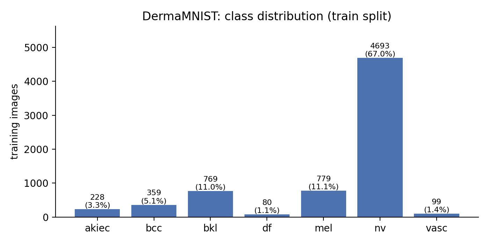
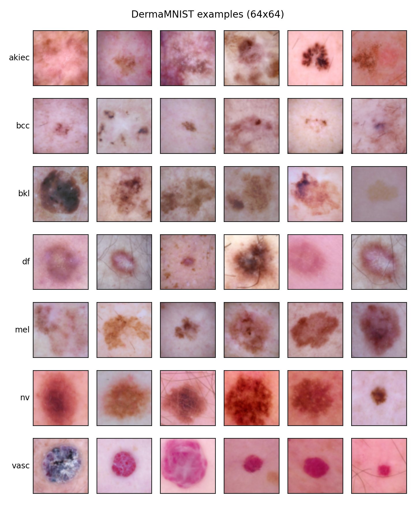
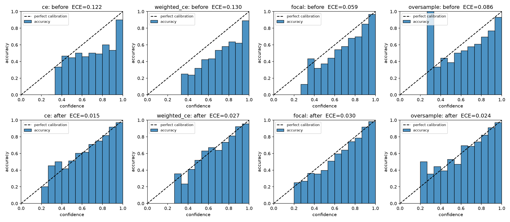
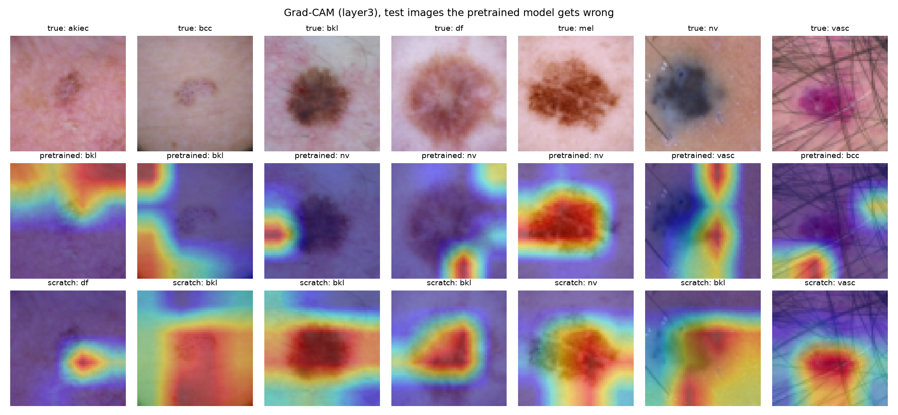

# Does ImageNet pretraining help on small, imbalanced medical images? A study on DermaMNIST


> **Status: v1.0.** Experiments, final test-set evaluation, calibration and Grad-CAM analysis are complete. A re-evaluation on the lesion-disjoint DermaMNIST-C is planned but **not started** (see [Future work](#future-work)).

**Question.** On DermaMNIST (7 skin-lesion classes, highly imbalanced), how do a small custom CNN, a ResNet-18 trained from scratch and an ImageNet-pretrained ResNet-18 compare? Which imbalance strategy works best, which augmentations help, is the model's confidence trustworthy (calibration), and where does it look (Grad-CAM)?

The training loop, early stopping, Focal Loss, Grad-CAM (with hooks) and temperature scaling are written by hand in PyTorch; the ResNet-18 architecture and its ImageNet weights come from torchvision.

## Key findings (test set, 3 seeds)
1. **Pretraining is the largest effect.** Test Macro-F1 is 0.692 ± 0.003 for the pretrained ResNet-18, 0.520 ± 0.045 for the same network from scratch and 0.436 ± 0.017 for the small CNN. The training settings were chosen with the pretrained model, so the gap is probably somewhat overstated for the other two.
2. **Pretraining is also worth a lot of data** (validation set, 2 seeds): a pretrained ResNet-18 trained on 25% of the training images already scores above the scratch model trained on all of them. See [validation experiments](docs/validation_experiments.md).
3. **No imbalance strategy is clearly better than plain cross-entropy** on Macro-F1 (weighted CE 0.656 ± 0.011, cross-entropy 0.640 ± 0.023, oversampling 0.632 ± 0.006, Focal 0.610 ± 0.004). Weighted CE trades 2 points of accuracy for better balanced accuracy and for recall on the rarest class `df`.
4. **Flips help; heavier augmentation trades precision for recall.** Flips raise Macro-F1 from 0.624 to 0.691. Rotation, colour jitter and zoom lower Macro-F1 and accuracy but raise balanced accuracy and melanoma recall (0.564 → 0.67–0.69), at the cost of recall on the majority class `nv` (0.89 → 0.75).
5. **Melanoma is the weak spot.** The final model finds 55% of melanomas (0.553 ± 0.047) and sends 28% of them to `nv`. No imbalance strategy changes this (0.48–0.53).
6. **The fine-tuned models are over-confident; temperature scaling fixes the average but not everything.** Test ECE falls from 0.12–0.13 to 0.02–0.03 for cross-entropy, weighted CE, oversampling and the final model, with no change in predictions. Over-confidence on predictions of the rare classes remains for some models.
7. **Grad-CAM does not show that the pretrained model concentrates on the lesion**, although the maps do depend on the learned weights (randomised-weights check passed).

## Data
DermaMNIST (from HAM10000, via the `medmnist` package), 64×64 RGB, official train / val / test split.

| Class | Lesion type | Train | Val | Test | Train % | Class weight |
|---|---|---:|---:|---:|---:|---:|
| akiec | Actinic keratoses / intraepithelial carcinoma | 228 | 33 | 66 | 3.25 | 4.39 |
| bcc | Basal cell carcinoma | 359 | 52 | 103 | 5.12 | 2.79 |
| bkl | Benign keratosis-like lesions | 769 | 110 | 220 | 10.97 | 1.30 |
| df | Dermatofibroma | 80 | 12 | 23 | 1.14 | 12.51 |
| mel | Melanoma | 779 | 111 | 223 | 11.12 | 1.29 |
| nv | Melanocytic nevi | 4693 | 671 | 1341 | 66.98 | 0.21 |
| vasc | Vascular lesions | 99 | 14 | 29 | 1.41 | 10.11 |
| **Total** | | **7007** | **1003** | **2005** | | |

The largest class is 59× the smallest (nv vs df). Class weights are computed on the training split only, as w_c = N / (K · n_c). The images are not included in this repository; they are downloaded by the code and are licensed CC BY-NC 4.0 by their authors.





## Models
| Model | Parameters | Initialization | Learning rate |
|---|---:|---|---|
| SmallCNN (3 conv blocks + GAP) | 288K | random | 1e-3 |
| ResNet-18 | 11.18M | random | 1e-3 |
| ResNet-18 | 11.18M | ImageNet | 1e-4 backbone, 1e-3 head |

The two ResNet-18s have the same architecture; only the initialization differs, so any gap between them is due to pretraining.

## Protocol
- AdamW (weight decay 1e-4), cosine learning-rate schedule, batch size 128, mixed precision on GPU. At most 40 epochs (60 in experiments D and E), early stopping with patience 8.
- Model selection and early stopping on **validation Macro-F1**. Accuracy is misleading here: always predicting `nv` gives 66.9% accuracy but only 0.115 Macro-F1.
- Experiments A–E ([details](docs/validation_experiments.md)) were run on the validation set and used to choose the settings: **weighted cross-entropy** (best balanced accuracy and rare-class recall in B, although its Macro-F1 difference from plain cross-entropy was within noise) and **horizontal + vertical flips** (best Macro-F1 in C), with the pretrained ResNet-18 as final model.
- These choices were frozen, and the **test set was then used once**. All results below are on the 2,005 test images, mean ± standard deviation (sample standard deviation) over 3 seeds. The test tables use the same checkpoints that were selected on validation.
- Validation loss is always plain cross-entropy, whatever loss a model is trained with, so runs are comparable.

## Final results (test set)

### 1. Model comparison
Weighted cross-entropy and flips for all three models.

| Model | Macro-F1 | Balanced acc. | Macro AUC | Accuracy |
|---|---:|---:|---:|---:|
| SmallCNN | 0.436 ± 0.017 | 0.548 ± 0.025 | 0.890 ± 0.006 | 0.586 ± 0.017 |
| ResNet-18, scratch | 0.520 ± 0.045 | 0.604 ± 0.045 | 0.922 ± 0.010 | 0.688 ± 0.024 |
| ResNet-18, ImageNet | **0.692 ± 0.003** | **0.693 ± 0.011** | **0.950 ± 0.004** | **0.806 ± 0.004** |

Recall per class (mean over 3 seeds):

| Model | akiec | bcc | bkl | df | mel | nv | vasc |
|---|---:|---:|---:|---:|---:|---:|---:|
| SmallCNN | 0.616 | 0.388 | 0.464 | 0.319 | 0.649 | 0.609 | 0.793 |
| ResNet-18, scratch | 0.561 | 0.557 | 0.462 | 0.420 | 0.559 | 0.763 | 0.908 |
| ResNet-18, ImageNet | 0.556 | 0.702 | 0.650 | 0.652 | 0.553 | 0.896 | 0.839 |

The pretrained model wins on every aggregate metric, but not on every class: the two small models have higher melanoma recall, bought with a much lower recall on `nv` (0.61 and 0.76 against 0.90). The comparison uses the settings chosen for the pretrained model, not settings optimised for each architecture.

### 2. Class-imbalance strategies
Pretrained ResNet-18, horizontal flip only.

| Strategy | Macro-F1 | Balanced acc. | Macro AUC | Accuracy |
|---|---:|---:|---:|---:|
| Cross-entropy | 0.640 ± 0.023 | 0.620 ± 0.026 | **0.947 ± 0.002** | **0.808 ± 0.008** |
| Weighted CE | **0.656 ± 0.011** | **0.662 ± 0.013** | 0.941 ± 0.002 | 0.790 ± 0.002 |
| Focal Loss (γ = 2, no class weights) | 0.610 ± 0.004 | 0.585 ± 0.007 | 0.946 ± 0.003 | 0.793 ± 0.006 |
| Oversampling | 0.632 ± 0.006 | 0.598 ± 0.022 | 0.942 ± 0.005 | 0.793 ± 0.020 |

Recall per class (mean over 3 seeds):

| Strategy | akiec | bcc | bkl | df | mel | nv | vasc |
|---|---:|---:|---:|---:|---:|---:|---:|
| Cross-entropy | 0.515 | 0.612 | 0.577 | 0.406 | 0.517 | 0.931 | 0.782 |
| Weighted CE | 0.556 | 0.625 | 0.597 | 0.623 | 0.522 | 0.893 | 0.816 |
| Focal | 0.535 | 0.583 | 0.571 | 0.304 | 0.483 | 0.920 | 0.701 |
| Oversampling | 0.414 | 0.595 | 0.582 | 0.362 | 0.528 | 0.913 | 0.793 |


**Observations**
1. Weighted CE has the highest mean Macro-F1 and balanced accuracy, but the Macro-F1 difference from cross-entropy (0.016) is smaller than the standard deviation of cross-entropy (0.023): the strategies are not clearly separated.
2. Weighted CE gives clearly the highest recall on `df` (0.62 against 0.30–0.41), but `df` has only 23 test images, so one image is worth 4 points.
3. **Melanoma recall is about the same for all four strategies (0.48–0.53).** None of them helps with the clinically most important class.

### 3. Augmentation ablation
Pretrained ResNet-18, weighted cross-entropy. The levels are cumulative.

| Augmentation | Macro-F1 | Balanced acc. | Macro AUC | Accuracy |
|---|---:|---:|---:|---:|
| None | 0.624 ± 0.018 | 0.616 ± 0.015 | 0.933 ± 0.001 | 0.792 ± 0.007 |
| Flips | **0.691 ± 0.004** | 0.707 ± 0.017 | **0.951 ± 0.004** | **0.802 ± 0.011** |
| + rotation | 0.643 ± 0.016 | 0.707 ± 0.005 | 0.948 ± 0.003 | 0.773 ± 0.011 |
| + colour jitter | 0.648 ± 0.004 | **0.721 ± 0.002** | 0.949 ± 0.001 | 0.757 ± 0.006 |
| + zoom (full) | 0.623 ± 0.047 | 0.714 ± 0.030 | 0.944 ± 0.006 | 0.723 ± 0.039 |

Recall per class (mean over 3 seeds):

| Augmentation | akiec | bcc | bkl | df | mel | nv | vasc |
|---|---:|---:|---:|---:|---:|---:|---:|
| None | 0.455 | 0.602 | 0.571 | 0.449 | 0.504 | 0.913 | 0.816 |
| Flips | 0.581 | 0.702 | 0.626 | 0.739 | 0.564 | 0.890 | 0.851 |
| + rotation | 0.566 | 0.725 | 0.661 | 0.609 | 0.668 | 0.823 | 0.897 |
| + colour jitter | 0.621 | 0.761 | 0.605 | 0.696 | 0.670 | 0.802 | 0.897 |
| + zoom (full) | 0.641 | 0.748 | 0.615 | 0.652 | 0.686 | 0.746 | 0.908 |

**Observations**
1. **Flips are the one clear win** (+0.067 Macro-F1, +0.09 balanced accuracy) at no cost in accuracy.
2. **Heavier augmentation moves the operating point:** melanoma recall rises from 0.56 to 0.67–0.69 and balanced accuracy to 0.71–0.72, but `nv` recall falls from 0.89 to 0.75 and accuracy from 0.80 to 0.72, and Macro-F1 drops because more `nv` images are flagged as lesions. Which point is "better" depends on the cost of a missed melanoma against a false alarm; Macro-F1 prefers flips only.
3. Per-class recall on the small classes is noisy: the flips row here and the pretrained row of Table 1 use identical settings except for the maximum number of epochs (40 against 60, which also changes the length of the cosine learning-rate schedule). Their Macro-F1 is the same (0.691 and 0.692), but their `df` recall differs by 0.09 (0.739 against 0.652).

### 4. Melanoma and the confusion matrix
For the final pretrained ResNet-18, melanoma recall is **0.553 ± 0.047**.


Most errors flow towards the majority class `nv`: 28% of true melanomas are predicted as `nv` (and 11% as `bkl`), and `bkl`, `df` and `vasc` lose 18%, 12% and 10% to `nv`. The largest confusion between two non-`nv` classes is `akiec` → `bcc` (21%). A good overall Macro-F1 does not mean every clinically important class is detected reliably.

### 5. Calibration
Temperature scaling divides all logits by one number T, fitted on **validation** logits only (LBFGS) and evaluated on the **test** set. Dividing by a positive number does not change the arg-max, so accuracy and F1 are unchanged. ECE uses 15 equal-width bins. The *rare-class gap* is the mean confidence minus the accuracy over predictions of `akiec`, `bcc`, `df` and `vasc` (positive = over-confident).

| Model | T | ECE before | ECE after | Rare-class gap before | Rare-class gap after |
|---|---:|---:|---:|---:|---:|
| Cross-entropy | 2.452 ± 0.211 | 0.129 ± 0.006 | 0.019 ± 0.004 | 0.243 ± 0.043 | 0.037 ± 0.041 |
| Weighted CE | 2.116 ± 0.057 | 0.127 ± 0.005 | 0.026 ± 0.002 | 0.257 ± 0.019 | 0.105 ± 0.018 |
| Focal Loss | 1.327 ± 0.112 | 0.066 ± 0.006 | 0.025 ± 0.007 | 0.136 ± 0.046 | 0.062 ± 0.051 |
| Oversampling | 2.319 ± 0.676 | 0.122 ± 0.032 | 0.025 ± 0.001 | 0.205 ± 0.028 | 0.023 ± 0.042 |
| *Final comparison:* SmallCNN | 1.029 ± 0.174 | 0.058 ± 0.023 | 0.046 ± 0.002 | 0.164 ± 0.043 | 0.159 ± 0.024 |
| *Final comparison:* ResNet-18, scratch | 1.234 ± 0.231 | 0.059 ± 0.036 | 0.030 ± 0.016 | 0.222 ± 0.092 | 0.167 ± 0.062 |
| *Final comparison:* ResNet-18, ImageNet | 2.278 ± 0.123 | 0.121 ± 0.004 | 0.018 ± 0.005 | 0.252 ± 0.003 | 0.095 ± 0.019 |



*Reliability diagrams for seed 0 (top: before, bottom: after scaling); the table gives the mean over 3 seeds. For oversampling, seed 0 (ECE 0.086 before) is better than the three-seed mean (0.122 ± 0.032).*

**Observations**
1. **The fine-tuned models are strongly over-confident** (ECE 0.12–0.13, T ≈ 2.1–2.5), except with Focal Loss (0.066), which down-weights the predictions the model is already sure about. This matches the validation-loss behaviour seen in experiment A: validation loss rises while Macro-F1 does not.
2. **Temperature scaling brings them to ECE 0.02–0.03.** The scratch and small models start better calibrated (ECE 0.058–0.059, T close to 1) and gain little.
3. **The hypothesis that weighted loss and oversampling make the model more over-confident on rare classes is not supported:** before scaling the rare-class gap of weighted CE (0.257) is similar to cross-entropy's (0.243) and that of oversampling (0.205) is lower, and Focal Loss is lowest (0.136). After scaling, weighted CE keeps the largest residual gap among the fine-tuned variants (0.105 ± 0.018); for cross-entropy and oversampling the standard deviation is as large as the mean.
4. **A good ECE hides class-dependent over-confidence.** The SmallCNN and the scratch ResNet have a low ECE after scaling but still a rare-class gap of about 0.16: when they predict a rare class, they are far more confident than they are right (their low `nv` recall suggests that many `nv` images end up in other classes). One global temperature cannot correct this.

### 6. Grad-CAM
Grad-CAM (layer3) for the pretrained and the scratch ResNet-18 on the first test image of each class that the pretrained model gets right (7 images) and wrong (7 images). The images are chosen by index, not by looks. Each model explains its own predicted class.




- At 64×64 the layer3 map is 4×4, and each cell has a very large receptive field, so locations are approximate. (`layer4` would be 2×2.) Grad-CAM with ReLU shows only positive evidence: a blue lesion means "no evidence for this class", not "ignored".
- For `vasc` the pretrained map sits on the lesion, and partly for `akiec`, `df` and `mel`. For `bcc`, `bkl` and `nv` it falls on the corners and borders of the image, with little evidence on the lesion itself. For a melanoma predicted as `nv` the map is strong on the lesion: the model looked at it and still got it wrong.
- In these images the scratch model's maps are more often centred on the lesion than the pretrained model's, including on its errors.
- **Sanity check** (Adebayo et al., 2018): the mean Spearman correlation between the maps of the trained model and of a model with random weights is −0.013 (median −0.049) over 200 test images; 1 of the 200 comparisons was undefined because a map was constant, and was excluded. Near zero means the maps depend on the learned weights, which is the desired outcome, but it is not evidence that the model "looks at the lesion". In the six images shown below, the random-weights maps are broad smooth blobs that often cover the lesion region.


Only 14 images are shown, so these are observations, not statistics. No claim about the pretrained model's focus is made.

## Limitations
- **Low resolution:** 64×64 images lose fine lesion detail, and ResNet-18 pretrained on 224×224 images is used on much smaller inputs (a 2×2 final feature map). Larger inputs were not tried.
- **One dataset, few seeds:** a single dataset; 3 seeds (2 in experiment E, with fixed training subsets, so its standard deviations reflect training randomness only). Several classes are tiny in the test set (`df` 23, `vasc` 29, `akiec` 66), so per-class recall is noisy.
- **Settings chosen with one model:** imbalance strategy and augmentation were selected on the pretrained ResNet-18 and one factor at a time (no interactions, no hyperparameter search); the other models did not get their own tuning. Focal Loss was only run with γ = 2 and no class weights.
- **Calibration:** T is fitted on 1,003 validation images; ECE on 2,005 test images with 15 bins is itself noisy.
- **Hardware:** seeds fix the randomness, but results can differ slightly between GPUs (the first baseline runs were trained on a T4, the other experiments on an RTX 3050).
- **Lesion-level leakage (important):** DermaMNIST is derived from HAM10000, which has several images per lesion (10,015 images from 7,470 lesions), and the official split was made at image level. Abhishek et al. (2025) report 886 images (641 lesions) overlapping between train and test, 440 (332) between train and validation, and 128 (113) between validation and test; counting lesions in more than one partition from their overlap numbers gives 1,006 of 7,470 (13.5%). The test numbers here may therefore be optimistic, and I cannot tell how this affects the comparison between models. The `.npz` file has no lesion IDs, so I did not rebuild a lesion-level split. See [Future work](#future-work).
- **No clinical use:** this is an educational and experimental study, not a validated diagnostic tool.

## Future work
**Re-evaluation on DermaMNIST-C (planned, not started).** Abhishek et al. released a corrected version, DermaMNIST-C, in which all images of a lesion that appears in the training set are moved from validation and test into training, so that no lesion is shared between partitions; they also released DermaMNIST-E (training on HAM10000, validation and test from ISIC 2018). The plan is to repeat the frozen pipeline (same settings, no new tuning) on DermaMNIST-C and compare with the results above. Practical notes: the released files are 28×28 and 224×224, so the 224×224 version would be resized to 64×64, and the partition sizes differ from the original split, so the two sets of results will only be compared qualitatively. Larger inputs and the two points under Limitations (per-model tuning, more seeds) would be natural follow-ups.

## Reproduce
```bash
pip install -r requirements.txt && pip install -e .
pytest -q
python scripts/eda.py --data_root data

# single run (experiment A)
python scripts/train.py --config configs/resnet18_pretrained.yaml --seed 0

# experiments B-E: sweeps over configs and seeds, then a mean ± std table
python scripts/sweep.py --configs configs/expB_*.yaml --seeds 0 1 2 --data_root data --out_dir results/runs
python scripts/summarize.py --runs_dir results/runs --names expB_ce expB_weighted_ce expB_focal expB_oversample --out results/expB
python scripts/sweep.py --configs configs/expC_*.yaml --seeds 0 1 2 --data_root data --out_dir results/runs --set loss=weighted_ce
python scripts/sweep.py --configs configs/expD_*.yaml --seeds 0 1 2 --data_root data --out_dir results/runs --set loss=weighted_ce augment=flips
# experiment E (2 seeds, only the two ResNet-18s), e.g. 10% of the data
python scripts/sweep.py --configs configs/expD_resnet18_scratch.yaml configs/expD_resnet18_pretrained.yaml --seeds 0 1 --data_root data --out_dir results/runs --suffix _frac10 --set loss=weighted_ce augment=flips train_fraction=0.1

# final evaluation: run once, after all settings are frozen
python scripts/evaluate_test.py        # test logits and metrics for every run
python scripts/test_tables.py          # tables, confusion matrix, recall figure
python scripts/test_calibration.py     # temperature scaling (fitted on val) evaluated on test
python scripts/gradcam_final.py        # Grad-CAM figures and sanity check
```
Summary tables are in `results/`; model checkpoints are not committed. The data are downloaded automatically into `data/` and are not part of the repository.

## References
1. Tschandl, P., Rosendahl, C., Kittler, H. (2018). The HAM10000 dataset. *Scientific Data* 5. https://doi.org/10.1038/sdata.2018.161
2. Yang, J., Shi, R., Ni, B. (2021). MedMNIST Classification Decathlon. *IEEE ISBI*. https://doi.org/10.1109/ISBI48211.2021.9434062
3. Yang, J. et al. (2023). MedMNIST v2. *Scientific Data* 10, 41. https://doi.org/10.1038/s41597-022-01721-8
4. Abhishek, K., Jain, A., Hamarneh, G. (2025). Investigating the Quality of DermaMNIST and Fitzpatrick17k Dermatological Image Datasets. *Scientific Data* 12, 196. https://doi.org/10.1038/s41597-025-04382-5 (corrected datasets: https://doi.org/10.5281/zenodo.12739457)
5. Selvaraju, R. R. et al. (2017). Grad-CAM: Visual explanations from deep networks via gradient-based localization. *ICCV*.
6. Guo, C., Pleiss, G., Sun, Y., Weinberger, K. Q. (2017). On calibration of modern neural networks. *ICML*.
7. Lin, T.-Y., Goyal, P., Girshick, R., He, K., Dollár, P. (2017). Focal loss for dense object detection. *ICCV*.
8. Adebayo, J. et al. (2018). Sanity checks for saliency maps. *NeurIPS*.
