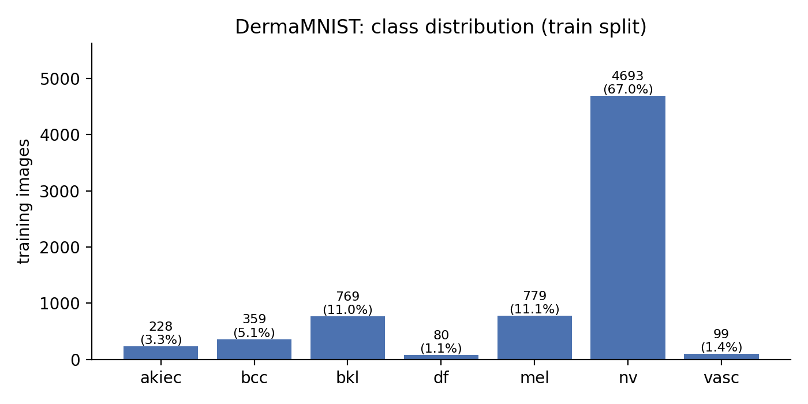

# Does ImageNet pretraining help on small, imbalanced medical images? A study on DermaMNIST

> Work in progress (day 1 of 3).

**Question.** On DermaMNIST (7 skin-lesion classes, highly imbalanced), how do a small custom CNN, a ResNet-18 trained from scratch and an ImageNet-pretrained ResNet-18 compare? Which imbalance strategy works best, is the model's confidence trustworthy (calibration), and where does it look (Grad-CAM)?

Everything is written in plain PyTorch: training loop, early stopping, Focal Loss, Grad-CAM (hooks) and temperature scaling.

## Data
DermaMNIST (MedMNIST v3, from HAM10000), 64×64 RGB, official train / val / test split.



## Models
| Model | Parameters | Initialization |
|---|---|---|
| SmallCNN (3 conv blocks + GAP) | _fill in_ | random |
| ResNet-18 | 11.18 M | random |
| ResNet-18 | 11.18 M | ImageNet |

## Setup
- Model selection and early stopping on **validation Macro-F1** (accuracy is misleading: always predicting the majority class gives ≈67%).
- The test set is used once, at the end.

## Results
_Coming on day 3._

## Reproduce
```bash
pip install -r requirements.txt && pip install -e .
pytest -q
python scripts/eda.py --data_root data
python scripts/train.py --config configs/resnet18_pretrained.yaml --seed 0
```
