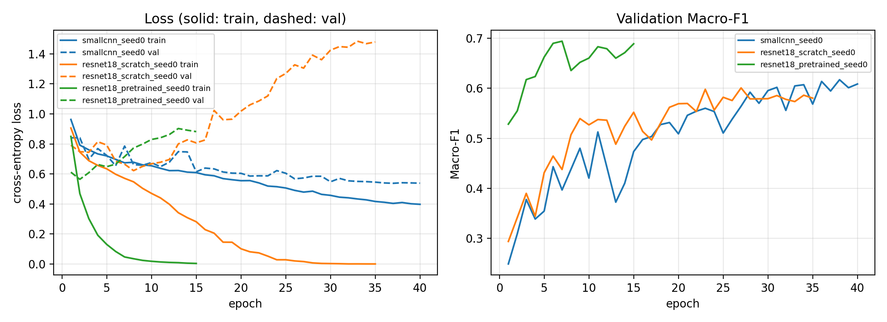

# Validation-set experiments (A–E)

These are the development experiments behind the settings used in the final evaluation. **All numbers on this page are on the validation set** (1,003 images); the final test-set results are in the [main README](../README.md). Tables report mean ± standard deviation over seeds (A: one seed; B, C, D: three seeds; E: two seeds).

Decisions taken from these experiments and then frozen: weighted cross-entropy (after B), horizontal and vertical flips (after C), and the pretrained ResNet-18 as the final model (after A and D).

## Experiment A: baseline (plain cross-entropy, horizontal flip, seed 0)

| Model | Macro-F1 | Balanced acc. | AUC (macro) | Accuracy | Best epoch / epochs run |
|---|---:|---:|---:|---:|---:|
| Always predict `nv` | 0.115 | 0.143 | – | 0.669 | – |
| SmallCNN | 0.617 | 0.575 | **0.951** | 0.812 | 38 / 40 |
| ResNet-18, scratch | 0.601 | 0.600 | 0.907 | 0.763 | 27 / 35 |
| ResNet-18, ImageNet-pretrained | **0.694** | **0.675** | 0.943 | **0.815** | 7 / 15 |

**Observations**
1. **Pretraining helps, and helps early.** The pretrained ResNet-18 reaches the best Macro-F1 (+0.09 over the same network trained from scratch) and gets there in 7 epochs instead of 27.
2. **The scratch ResNet-18 memorizes the training set.** Its training loss drops to ≈0 while its validation loss climbs from 0.62 to 1.48: 11M parameters on 7k images overfit badly without pretraining. The 39× smaller SmallCNN matches it in Macro-F1 and beats it in AUC.
3. **SmallCNN has not finished learning.** Its validation loss is still decreasing and its best epoch is 38 of 40, so it is limited by the training budget, not by overfitting.
4. **Validation loss and Macro-F1 disagree.** For the pretrained model, validation loss is lowest at epoch 2 and rises afterwards, while Macro-F1 keeps improving until epoch 7. The model keeps getting the same images right but becomes over-confident on the ones it gets wrong. The calibration analysis in the main README (test set) confirms this.
5. **High AUC, lower Macro-F1.** SmallCNN ranks the classes well (AUC 0.951) but its arg-max decisions favour the majority class (balanced accuracy 0.575). This is the gap that the imbalance strategies are meant to close.

**Caveat.** One seed, and only 12 `df` and 14 `vasc` images in validation, so differences of 1–2 points are within noise. The later experiments use 3 seeds.

## Experiment B: class-imbalance strategies (pretrained ResNet-18, 3 seeds)

Only the imbalance strategy changes; everything else is as in A (horizontal flip only).

| Strategy | Macro-F1 | Balanced acc. | AUC (macro) | Accuracy |
|---|---:|---:|---:|---:|
| Cross-entropy (baseline) | **0.674 ± 0.006** | 0.656 ± 0.005 | 0.944 ± 0.003 | **0.813 ± 0.002** |
| Weighted cross-entropy | 0.672 ± 0.026 | **0.670 ± 0.018** | 0.940 ± 0.006 | 0.794 ± 0.014 |
| Focal Loss | 0.661 ± 0.020 | 0.628 ± 0.024 | 0.940 ± 0.004 | 0.804 ± 0.007 |
| Oversampling | 0.666 ± 0.011 | 0.624 ± 0.015 | 0.945 ± 0.002 | 0.801 ± 0.028 |

Per-class recall (mean over 3 seeds):

| Strategy | akiec | bcc | bkl | df | mel | nv | vasc |
|---|---:|---:|---:|---:|---:|---:|---:|
| Cross-entropy | 0.545 | 0.718 | 0.573 | 0.556 | 0.538 | 0.925 | 0.738 |
| Weighted CE | 0.556 | 0.667 | 0.588 | 0.667 | 0.559 | 0.891 | 0.762 |
| Focal | 0.525 | 0.673 | 0.582 | 0.500 | 0.529 | 0.918 | 0.667 |
| Oversampling | 0.485 | 0.699 | 0.600 | 0.528 | 0.583 | 0.904 | 0.571 |

**Observations**
1. **The four strategies are statistically indistinguishable on Macro-F1** (0.661–0.674, with standard deviations up to 0.026). Plain cross-entropy has the highest mean and the lowest variance.
2. **Weighted CE is the only one that moves the balance**: it gives the best balanced accuracy and the best recall on `df` and `vasc`, but loses 2 points of accuracy. The gain in balanced accuracy (+0.014) is smaller than its standard deviation.
3. **The class-imbalance problem is not solved by re-weighting at this data size.** With 12 `df` and 14 `vasc` validation images, one image changes recall by 7–8 points, so per-class recall differences here are mostly noise.
4. The baseline run `expB_ce_seed0` reproduces experiment A (0.694 in A, 0.674 ± 0.006 over three seeds), which is a useful consistency check.

## Experiment C: augmentation ablation (pretrained ResNet-18, 3 seeds)

Five cumulative levels. Imbalance strategy: **weighted cross-entropy** for all levels, chosen after B because it gave the best balanced accuracy and the best recall on the rarest classes (its Macro-F1 difference from plain cross-entropy was within noise).

| Level | Adds | Macro-F1 | Balanced acc. | AUC (macro) | Accuracy | Best epoch |
|---|---|---:|---:|---:|---:|---:|
| 0 none | – | 0.635 ± 0.013 | 0.614 ± 0.008 | 0.936 ± 0.003 | 0.784 ± 0.007 | 17.7 |
| 1 flips | horizontal + vertical flip | **0.685 ± 0.021** | 0.698 ± 0.010 | **0.943 ± 0.006** | **0.797 ± 0.016** | 23.3 |
| 2 flips_rot | rotation (any angle) | 0.663 ± 0.011 | 0.729 ± 0.015 | 0.941 ± 0.008 | 0.763 ± 0.006 | 30.0 |
| 3 flips_rot_color | mild brightness / contrast / saturation / hue jitter | 0.649 ± 0.008 | **0.731 ± 0.021** | 0.941 ± 0.005 | 0.753 ± 0.006 | 30.0 |
| 4 full | random zoom (80–100%) | 0.627 ± 0.013 | 0.710 ± 0.011 | 0.938 ± 0.006 | 0.707 ± 0.022 | 30.3 |

Recall of selected classes:

| Level | akiec | bcc | mel | vasc | nv |
|---|---:|---:|---:|---:|---:|
| 0 none | 0.444 | 0.705 | 0.532 | 0.667 | 0.903 |
| 1 flips | 0.535 | 0.763 | 0.580 | 0.857 | 0.881 |
| 2 flips_rot | 0.667 | 0.821 | 0.640 | 0.833 | 0.804 |
| 3 flips_rot_color | 0.717 | 0.853 | 0.679 | 0.857 | 0.788 |
| 4 full | 0.646 | 0.840 | 0.670 | 0.905 | 0.725 |

**Observations**
1. **Flips are the one clear win**: +0.05 Macro-F1 and +0.08 balanced accuracy over no augmentation, with no cost in accuracy.
2. **Each further level trades the majority class for the minority classes.** Recall on `akiec`, `bcc` and `mel` keeps rising up to levels 3–4, while `nv` recall falls from 0.90 to 0.73. Balanced accuracy goes up, but Macro-F1 goes down, because more `nv` images are misclassified as lesions and rare-class precision drops. If the clinical priority is catching lesions rather than avoiding false alarms, level 2–3 is the better operating point; for Macro-F1, level 1.
3. **Stronger augmentation delays the best epoch** (17.7 → 30), i.e. it slows down overfitting, as expected.
4. Rotation leaves black corners on 64×64 images; zoom on such small images may crop away the lesion's border. Both are plausible reasons why the heaviest level does not help.

## Experiment D: final comparison of the three models (3 seeds)

Same settings for all three models: **weighted cross-entropy and horizontal + vertical flips** (the choices made after B and C), at most 60 epochs.

| Model | Macro-F1 | Balanced acc. | AUC (macro) | Accuracy | Best epoch |
|---|---:|---:|---:|---:|---:|
| SmallCNN | 0.446 ± 0.013 | 0.553 ± 0.049 | 0.903 ± 0.013 | 0.591 ± 0.024 | 10.7 |
| ResNet-18, scratch | 0.522 ± 0.036 | 0.590 ± 0.030 | 0.921 ± 0.006 | 0.686 ± 0.034 | 15.7 |
| ResNet-18, pretrained | **0.684 ± 0.012** | **0.690 ± 0.017** | **0.940 ± 0.006** | **0.807 ± 0.013** | 23.0 |

Recall per class:

| Model | akiec | bcc | bkl | df | mel | nv | vasc |
|---|---:|---:|---:|---:|---:|---:|---:|
| SmallCNN | 0.566 | 0.449 | 0.467 | 0.389 | 0.649 | 0.615 | 0.738 |
| ResNet-18, scratch | 0.525 | 0.641 | 0.439 | 0.472 | 0.577 | 0.759 | 0.714 |
| ResNet-18, pretrained | 0.505 | 0.769 | 0.630 | 0.611 | 0.586 | 0.893 | 0.833 |

**Observations**
1. **The pretrained model wins on every metric** and by a wide margin: +0.16 Macro-F1 over scratch, +0.24 over the small CNN, with the lowest variance across seeds.
2. **The ranking of A is not reproduced for the small models.** In A the small CNN (0.617) and the scratch ResNet-18 (0.601) were close to each other and much closer to the pretrained model. Here both are lower than in A (0.446 and 0.522), while the pretrained model is unchanged (0.694 in A, 0.684 here). Their low accuracy and low `nv` recall (0.62 and 0.76) show that they are pushed towards the minority classes, plausibly by the weighted loss (weight 12.5 on `df` against 0.21 on `nv`), which a small-capacity model cannot absorb. This comparison is therefore "each model under the settings chosen for the pretrained model", not "each model at its own optimum"; the gap to the pretrained model is probably overstated.
3. Early stopping ended the small models early (mean best epoch 10.7 and 15.7 of 60), so they were not limited by the epoch budget here.

## Experiment E: how much data? (2 seeds, same settings as D: weighted CE + flips, validation set)

Stratified subsets of the training set (class proportions preserved, identical for both models). The 100% row is experiment D (3 seeds).

| Training data | Images | Scratch Macro-F1 | Pretrained Macro-F1 | Gap |
|---|---:|---:|---:|---:|
| 10% | ≈700 | 0.398 ± 0.019 | 0.484 ± 0.038 | +0.085 |
| 25% | ≈1,750 | 0.474 ± 0.043 | 0.583 ± 0.012 | +0.109 |
| 50% | ≈3,500 | 0.519 ± 0.049 | 0.627 ± 0.024 | +0.108 |
| 100% | 7,007 | 0.522 ± 0.036 | 0.684 ± 0.012 | +0.162 |

**Observations**
1. **Pretrained is better at every size.** A pretrained model with 25% of the data (0.583) already beats the scratch model with all of it (0.522).
2. **The scratch model plateaus** between 50% and 100% (0.519 vs 0.522), while the pretrained model keeps improving.
3. **The initial hypothesis (pretraining matters most when data is scarcest) is not supported:** the gap does not shrink with more data in the range tested. With 2 seeds and standard deviations up to 0.05, the gaps at 10%, 25% and 50% are not distinguishable from each other.
4. **At 10% data, AUC is almost identical for the two models (0.858 vs 0.859) while Macro-F1 differs (0.484 vs 0.398).** AUC only measures how well each class is ranked, whereas Macro-F1 depends on the final arg-max decisions, which AUC does not capture. We did not investigate the cause and claim no explanation; with only 2 seeds the standard deviations are large (up to ±0.04 in F1 and ±0.023 in AUC for the pretrained model).
